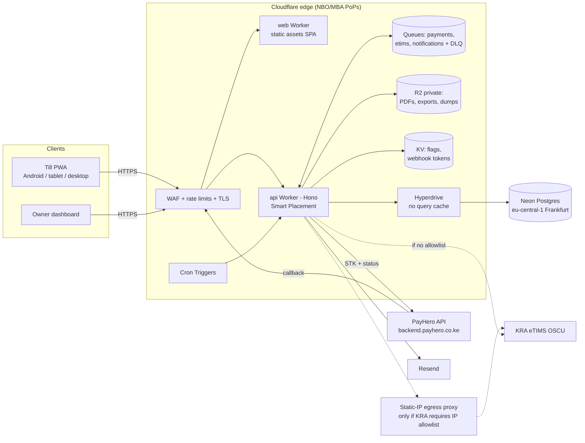

# Kenya POS — SDLC Review & Build Plan

Source: `kenya_pos_sdlc.md`. Part A lists where the SDLC needs fixing. Part B is the build plan, with those fixes and **PayHero** (one PayHero account per business) included.

---

## Part A — SDLC review: gaps and proposed changes

### A1. Contradictions to resolve
| # | Issue | Fix |
|---|---|---|
| 1 | §4 puts M-Pesa STK Push **in the MVP**, but §11 Gate 1 says MVP has **manual payments only**, and Phase 4 adds M-Pesa later. | MVP = manual payments + PayHero STK Push. PayHero is one REST call plus a callback, much smaller than direct Daraja. Make it Gate 1.5 (Sprint 6). |
| 2 | §4/§5 assume **Daraja** directly. | Replace with **PayHero** as the payment provider (one adapter). Keep a `PaymentProvider` interface so Daraja or others can be added later. |
| 3 | Suppliers/POs are in the MVP table (§4) but Gate 2 (§11). | Keep them in Gate 2. An MVP for retail tills doesn't need POs; opening stock + "stock received" adjustments are enough. |
| 4 | §12 decisions are still open, but Phases 2–3 depend on them. | Lock them before Sprint 0 (defaults proposed in B1). |

### A2. Missing for a real Kenyan POS
1. **The till itself.** The doc is centred on invoices. Retail needs a fast **cash sale screen**: barcode scan, cart, tender (cash / M-Pesa / credit / split), change due, receipt. Add it as its own module.
2. **Shifts and cash-up.** Open/close a till session with an opening float, X/Z reports, expected vs counted cash, and variance with a reason. This is the main way owners control cashiers. It is missing entirely.
3. **Returns at the till.** Return against an original receipt, restock or write-off, refund method, supervisor approval.
4. **Units of measure and price tiers.** Selling by carton/piece/kg with conversions, plus retail/wholesale price lists. Very common for hardware shops and wholesalers.
5. **Receipt hardware.** 58/80 mm thermal printers (browser print with 80 mm CSS first; Bluetooth ESC/POS on Android later), USB/keyboard-wedge barcode scanners, cash drawer kick.
6. **eTIMS changes the sale flow, not only reporting.** The receipt/invoice must carry the eTIMS signature data (CU invoice no., QR) once integrated. Design the receipt and invoice-finalisation step around an `etims_status` from day 1, even while it is stubbed. Also plan for KRA item classification and packaging/unit codes on products. Verify current KRA rules on whether non-VAT businesses must issue eTIMS invoices.
7. **Payment callbacks aren't signed.** PayHero's docs show no callback signature. Treat a callback only as a trigger: confirm with `GET /api/v2/transaction-status?reference=…` before allocating. Also use a per-tenant secret token in the callback URL. This makes §10's "validate authenticity" concrete.
8. **Unmatched and manual M-Pesa.** Customers often pay to the till directly without STK. Add a "record M-Pesa ref" tender, an unmatched-payments queue, and CSV statement import for reconciliation.
9. **Offline policy.** Kenyan connectivity and power cuts make this a day-1 design decision, not a later one. Even if offline mode ships later, every sale gets a **client-generated UUID + idempotency key** from Sprint 3, so a queued sale can't post twice.
10. **Concurrency rules.** Two cashiers selling the last unit, two people converting the same quotation, and parallel callbacks. Use row locks and unique constraints, and test each case.
11. **Negative stock policy** (allow / warn / block), configured per business.
12. **Notifications channel.** The doc doesn't say how alerts are sent. Proposal: in-app always; email (Resend) for owners; SMS/WhatsApp (Africa's Talking) as a paid add-on later.
13. **Data protection.** Kenya Data Protection Act 2019: register with ODPC, sign a DPA with each tenant, set retention periods, handle access/deletion requests.
14. **Onboarding/import.** CSV import of products, opening stock, and customers is needed for the Phase 6 pilot but isn't a sprint task.
15. **Time zone and rounding.** All "daily" reports use Africa/Nairobi day boundaries. Define VAT-inclusive rounding per line vs per invoice, and keep money in integer cents.
16. **SaaS operations.** Subscription billing is in Gate 4, but a SaaS needs a super-admin (tenant list, suspend, impersonate with audit) from the pilot. Pilots can be free.

### A3. Acceptance tests to add (§9)
- Shift close: counted cash minus expected cash equals the variance, which is posted and audited.
- Same sale UUID submitted twice: one sale posted.
- Two terminals sell the last unit at once: the negative-stock policy is enforced.
- Callback arrives but transaction-status says failed: invoice stays unpaid.
- Callback for an unknown reference: lands in the unmatched queue.
- Tenant A's PayHero credentials are never readable by tenant B or in the API responses (write-only).
- VAT-inclusive totals match the line-level tax sum within the rounding rule.
- Daily report around 00:00 EAT: the sale falls on the correct business day.

### A4. Process and schedule
- Phase 1 (interviews) and Phase 6 (pilot) are your work; Devin can't interview businesses. Run Phase 1 in parallel with Sprint 0–1 rather than blocking on it.
- Phase 2: produce 2–3 clickable sample designs of the till + dashboard to choose from before UI code.
- Use one PR per sprint, each with lint + build. **Unit tests are required for money, tax, stock-ledger, and allocation logic.** This is the one place to go beyond "lint + build only", because these bugs cost real money.
- The 10-week timeline is fine for the build. eTIMS certification and pilot feedback are the schedule risks, not code.

---

## Part B — Build plan

### B1. Decisions (proposed defaults; confirm or override)
| Decision | Default | Why |
|---|---|---|
| Target segment | Retail shops + small wholesalers (incl. hardware) | Same till + credit-sale flow; UoM/price tiers cover wholesale |
| Platform | Mobile-friendly **PWA** web app (Android Chrome, tablet, desktop) | One codebase; offline queue can be added later |
| Business model | Multi-tenant SaaS | Matches SDLC §5 |
| Payments | **PayHero**, one account per business, credentials entered by the owner on the dashboard | Your requirement |
| Dev approach | AI-assisted solo (Devin builds and refines per sprint) | |
| Repo | New repo `Kirwa00/kenya-pos` (name TBC) | Standalone; nothing shared with other repos |

### B2. Stack (Cloudflare Workers)
- **Monorepo** (npm workspaces + turbo):
  - `apps/web`: React + Vite + TS + Tailwind **PWA**, served as Workers Static Assets.
  - `apps/api`: **Hono** on Workers.
  - `packages/shared`: zod schemas plus money/tax/stock maths, with unit tests.
- **Why a Vite SPA, not Next.js, for the app:**
  - A POS is an app shell plus API. It needs no SSR, and an SPA is the best base for offline/IndexedDB.
  - It also avoids the OpenNext version pinning and build traps seen on suluhu-clone.
  - A marketing site can be a separate static Worker later.
- **Database:**
  - Neon Postgres via **Hyperdrive**, accessed through Prisma with a driver adapter (as in suluhu-clone).
  - Money is stored as `Decimal(14,2)`.
  - Tenant isolation uses `business_id` on every row, a Prisma extension, and Postgres **RLS**. RLS gets the tenant from `SET LOCAL app.business_id` inside each transaction, which is safe with Hyperdrive's transaction pooling.
- **Background work:**
  - **Queues** + **Cron Triggers** replace BullMQ/Redis: `payments` (PayHero status re-checks), `etims` (submission retries), `notifications`, each with a dead-letter queue.
- **Storage:**
  - **R2** (private) holds PDFs, exports, CSV imports and nightly DB dumps.
  - **KV** holds feature flags and the per-tenant webhook token lookup cache.
  - The Workers **Rate Limiting** binding protects login/OTP/STK endpoints.
- **Auth:**
  - Email + password with PBKDF2-SHA256 via WebCrypto, at 100k iterations (the workerd max, a lesson from suluhu-clone).
  - Short-lived JWT plus a rotating refresh token in the DB.
  - Cashier PIN quick-switch is scoped to an open till session.
- **PDFs:** generate in the Worker with `pdf-lib` (pure JS, Paid-plan CPU is ample) and store them in R2. Fallback: Browser Rendering.
- **Email:** Resend HTTP API.
- **Plan:** **Workers Paid ($5/mo) is required.** The Free plan's 10 ms CPU cap caused intermittent error 1102 on login in suluhu-clone; Paid allows 30 s by default.

### B3. PayHero integration design
**Per-business "Payments" settings page** (Owner role only), at Dashboard → Settings → Payments:
- Fields:
  - PayHero **API username**
  - **API password** (the Basic-auth token pair from the PayHero dashboard)
  - **Channel ID** (a picker filled by `GET /api/v2/payment_channels` after the credentials are saved)
  - Optional `credential_id` (their own Daraja keys inside PayHero)
- **Test connection** button calls `GET /api/v2/payment_channels` and shows the till/paybill found.
- **Enable / disable** toggle. When off, the till hides the STK tender (manual M-Pesa ref is still allowed).
- Credentials are **encrypted at rest** (AES-256-GCM, app key from env) and **write-only**: the API returns only `••••last4` and status, never the secret. Changes are audit-logged.
- Callback URL is generated per business: `https://api.<domain>/webhooks/payhero/<businessId>/<secretToken>`. It is shown read-only for reference; PayHero receives it per request.

**Flow**
1. Cashier picks STK tender and enters the phone. The API creates a `payment_request` (PENDING, idempotency key = sale/invoice UUID) and calls `POST https://backend.payhero.co.ke/api/v2/payments` with `{amount, phone_number, channel_id, provider:"m-pesa", external_reference:<payment_request id>, customer_name, callback_url}`. It stores the returned `reference` and `CheckoutRequestID`.
2. The till polls the status. The invoice stays **unpaid**.
3. Callback arrives (`response.ExternalReference`, `MpesaReceiptNumber`, `ResultCode`, `Amount`). The API checks the URL token, then **verifies with `GET /api/v2/transaction-status?reference=…`** using that tenant's credentials.
4. On success it allocates to the invoice inside a DB transaction, using a unique `(business_id, mpesa_receipt)` constraint so a duplicate callback is a no-op. Then it issues the receipt.
5. No callback within N minutes: the `payments` queue (delayed message) or the 1-min cron sweep re-checks transaction-status, then marks FAILED or EXPIRED.
6. Any amount mismatch or unknown reference goes to the **unmatched payments** queue for manual allocation.

Code lives behind `PaymentProvider` (`initiate`, `getStatus`, `listChannels`) with a `PayHeroProvider` and a `MockProvider` for local and CI.

> Verify with PayHero before go-live: their callback retry behaviour, sandbox/test mode availability, and whether they offer a partner/sub-account API (which could replace manual credential entry later).

### B4. Core data model (adds to SDLC §7)
These tables are added to the SDLC's entity list:
- `till_sessions` (shifts)
- `sales` (till sales; invoices are reused for credit)
- `price_lists`
- `units_of_measure` + `product_uoms`
- `payment_provider_configs` (business_id, provider, enc_credentials, channel_id, enabled)
- `payment_requests`
- `unmatched_payments`
- `idempotency_keys`

Design rules:
- `stock_movements` is an **append-only ledger**. On-hand quantity and weighted-average cost are derived from it or cached, never edited.
- Document numbers come from a per-business/branch `sequences` table, issued under a row lock.

### B5. Sprint plan (one PR per sprint)
| Sprint | Scope | Exit criteria |
|---|---|---|
| **S0 Foundation** | Monorepo, CI (lint/typecheck/build/unit + `wrangler deploy --dry-run`), local dev (wrangler dev + Docker Postgres), Cloudflare/Neon provisioning (staging + prod), auth (email+password; cashier PIN switch), businesses/branches/users/roles/permissions, RLS + tenant guard, audit log, seed, super-admin stub | Cross-tenant access test denied |
| **S1 Catalog & customers** | Categories, products/SKU/barcode, UoM conversions, price tiers, tax categories (16%/0%/exempt, incl/excl), customers (KRA PIN, credit limit), CSV import | Import 500 products from CSV |
| **S2 Stock ledger** | Opening stock, adjustments with reason + approval, stock counts → variance, weighted-avg cost, negative-stock policy, low-stock alert (in-app) | Ledger sums equal on-hand; count variance posted |
| **S3 Till / POS** | Sale screen (scan, search, cart, discounts by permission), tenders: cash, manual M-Pesa ref, credit, split; 80 mm receipt; till sessions + X/Z + cash-up; returns; sale UUID idempotency | Duplicate submit posts once; shift variance correct |
| **S4 Quotes & invoices** | Quotations → one-click invoice (no double convert), sequences, PDF + share link, partial payments, manual allocation, credit notes/refunds, statements, ageing | All §9 quotation and partial-payment tests pass |
| **S5 Reports (Gate 1 / MVP)** | Daily/weekly/monthly sales; by product/category/cashier/tender; gross profit; stock valuation; debtors; dashboard "cash vs sales vs profit" | Report totals agree with ledgers. **Pilot-ready** |
| **S6 PayHero** | Settings → Payments page (creds, test connection, channel picker, toggle), encrypted storage, STK tender at till and on invoices, callback + status verification, retry job, unmatched queue, M-Pesa CSV import | Duplicate callback no-op; failed status leaves invoice unpaid |
| **S7 Suppliers & procurement** | Suppliers, PO + approval, GRN with discrepancies (stock only on receipt), supplier invoices/payments, creditors | PO alone changes no stock |
| **S8 Alerts & reminders** | Notification centre, email to owners (Resend), overdue reminders, failed/pending payments, POs awaiting action, daily owner summary | Jobs run on schedule, idempotent |
| **S9 Tax & eTIMS groundwork** | Tax records separated from revenue, KRA item/unit code mapping, `EtimsAdapter` (OSCU sandbox) + submission queue/retries, reconciliation report (missing/duplicate/mismatched), expenses + P&L | Reconciliation flags all seeded mismatches |
| **S10 Hardening** | Security review, WAF/rate-limit rules, backup (R2 dump) + Neon restore drill, perf on low bandwidth, PWA install; offline sale queue if chosen | Definition of done (§9) met. **Pilot launch** |

Gate 4 items come after the pilot: multi-branch transfers, subscription billing, advanced analytics.

### B6. Cloudflare architecture & network

**Domains and DNS.** The domain must be a zone on Cloudflare. A `.co.ke` can use Cloudflare DNS (nameserver change at the registrar) but can't be bought through Cloudflare Registrar.

| Host | Points to | Notes |
|---|---|---|
| `<domain>` / `www` | marketing (static Worker, later) | |
| `app.<domain>` | `pos-web` Worker (custom domain) | SPA + service worker; CSP locked to `api.<domain>` |
| `api.<domain>` | `pos-api` Worker (custom domain) | CORS allow only `https://app.<domain>` |
| `api.<domain>/webhooks/payhero/:businessId/:token` | same Worker | No CORS/auth; token check, then transaction-status verify |
| `staging-app.<domain>`, `staging-api.<domain>` | staging Workers | Neon `staging` branch; mock PayHero by default |

Custom domains get automatic TLS. Delete any old A/CNAME records on those hostnames before attaching them (suluhu-clone gotcha).

**Edge security**
- SSL mode *Full (strict)*, HSTS, minimum TLS 1.2.
- Free Managed WAF ruleset on.
- **Keep Bot Fight Mode OFF.** Cloudflare's docs say it can't be skipped by WAF rules, so it would challenge PayHero's server-to-server callbacks. Use WAF custom rules + rate limiting instead, or Super Bot Fight Mode (Pro plan, supports Skip) on everything except `/webhooks/*`.
- Turnstile on sign-up and login.
- Rate limits via the Workers binding: login 5/min/IP, STK initiate 10/min/till, webhook 120/min per business.
- PayHero publishes no callback IPs or signature, so security is the unguessable per-tenant URL token plus the **mandatory** `transaction-status` re-check.

**Latency and placement**
- Neon has no African region. Frankfurt (`aws-eu-central-1`) is the closest: roughly 150 ms round trip from Nairobi (estimate, measure in S0).
- Enable **Smart Placement** on `pos-api` so the Worker runs near the DB and the client only pays one edge hop.
- Batch queries per request (one transaction per sale).
- Static app assets are served from the Nairobi/Mombasa PoPs.

**Hyperdrive caching OFF** (`--caching-disabled`). Cached SELECTs served stale reads for about 60 s on suluhu-clone. That is unacceptable for stock balances and payment status.

**Outbound (egress)**
- Workers egress from shared Cloudflare IPs, with no static IP below Enterprise.
- PayHero and Resend don't need allowlisting.
- **Risk:** if KRA's OSCU onboarding requires a whitelisted source IP, add a tiny static-IP egress proxy (a Fly.io machine with a dedicated IPv4, ~$2/mo) behind an `ETIMS_BASE_URL` env. VSCU (a locally run Java service) can't run on Workers, so plan on **OSCU**.

**Cron schedule** (UTC, with the EAT equivalent)
- `* * * * *`: sweep PENDING PayHero requests older than 2 min.
- `*/15 * * * *`: retry eTIMS submissions.
- `0 5 * * *` (08:00 EAT): overdue-invoice reminders and low-stock digest.
- `0 17 * * *` (20:00 EAT): daily owner summary.
- `30 23 * * *` (02:30 EAT): R2 export marker. The actual `pg_dump` to R2 runs from a nightly GitHub Action, because Workers can't run `pg_dump`.

**Secrets** (`wrangler secret`; never in `wrangler.jsonc`)
- `JWT_SECRET`
- `CREDENTIALS_KEY` (AES-256-GCM key for tenants' PayHero credentials)
- `RESEND_API_KEY`
- `TURNSTILE_SECRET`
- `ETIMS_*` (later)
- The DB connection lives only in the Hyperdrive config.

**Backups and DR**
- Neon point-in-time restore (window depends on plan).
- Nightly logical dump to R2, 30-day lifecycle.
- A restore drill in S10.
- `wrangler rollback` for bad Worker deploys.

**Environments**
- `local`: wrangler dev + Docker Postgres, `PAYMENTS_MODE=mock`.
- `staging`: Neon branch, PayHero test account.
- `prod`.

**CI/CD**
- GitHub Actions runs lint/typecheck/test/build on PRs.
- On merge to `main`, it runs `wrangler deploy` for staging, then prod with a manual approval.
- Prisma migrations run in Actions against Neon.
- To avoid suluhu-clone's access gap, give Devin a scoped Cloudflare API token + account ID as Devin secrets (Workers, R2, Queues, Hyperdrive, DNS edit on this zone only) so it can provision and debug directly.

**Estimated monthly cost at pilot scale**
- Workers Paid: $5 (includes Queues, Hyperdrive and KV allowances).
- R2: about $0 (10 GB free).
- Neon: free to start, ~$19 Launch for PITR/production.
- Resend: free tier.
- Optional egress proxy: about $2.
- **Total ≈ $5–26/mo** (check current pricing before committing).

### B7. Scale target: 1,000 businesses

**Load model.** These are estimates to validate in the S10 load test.
- 1,000 businesses × ~2 tills × 50–200 sales/day = **50k–200k sales/day**.
- About 15% of a day's sales land in the busiest hour, which is roughly **3–10 sales per second at peak**.
- Each sale is about 5–10 API calls, so the API sees **~50–150 requests per second at peak**. Workers handle that without effort.
- **Database growth:** every sale writes its lines plus stock movements, about **0.5–2M rows/day**. That is ~200–700M rows/yr, or roughly **50–250 GB/yr** with indexes. The database is the part that needs design.

| Layer | Holds at 1,000 tenants? | What makes it hold |
|---|---|---|
| Edge / Workers | Yes, with large headroom | Stateless and auto-scaled. Watch CPU per request and keep reports in queues. |
| Hyperdrive → Neon | Yes, with design | Connection pooling. One transaction per sale. Indexes start with `business_id`. |
| Ledger tables | Needs work by S5 | Monthly **partitioning** of `sales`, `invoice_items` and `stock_movements`. A cached `stock_balances` table updated in the same transaction. |
| Reports | Needs work by S5 | Daily **rollup tables** (sales/tax/COGS per business per day) updated by queue. Dashboards read rollups, never scan ledgers. Big reports run as queued jobs → R2 file → notification. |
| Noisy neighbour | Needs controls | Per-tenant rate limits and quotas, report jobs throttled per tenant, query timeouts (`statement_timeout`). A Neon **read replica** for reports once more than ~300 tenants. |
| Payments | Isolated per tenant | Each tenant has its own PayHero credentials, so one bad account affects only that tenant. A PayHero-wide outage falls back to the manual M-Pesa ref tender. |
| eTIMS | Queue absorbs KRA outages | Submissions retry with backoff and a DLQ. Sales never block on KRA. |

**Single points of failure and their mitigations**
1. **Neon (one region).** Neon storage is replicated, but a regional or compute outage stops all tenants.
   - The **offline sale queue** (PWA + IndexedDB + idempotency keys) is what keeps tills selling, so it moves from "optional" to **required before ~100 tenants**.
   - Run PITR plus the nightly R2 dump, and do a restore drill every quarter.
2. **Cloudflare.** Outages are rare and global. The offline queue covers them too.
3. **Bad deploy.** Deploy to staging first, run smoke tests, then `wrangler rollback`. Use feature flags in KV for risky features.

**Observability**
- Workers Logs/Logpush and Sentry for errors.
- Uptime checks on `app.` and `api.` plus a status page.
- Per-tenant metrics: requests, errors, queue lag, DLQ depth.
- Alerts on stuck PENDING payments and failed eTIMS submissions.

**Cost at 1,000 tenants.** Rough figures; check current pricing.
- Workers Paid + requests/Queues: ~$20–60.
- Neon Scale + compute + storage + replica: ~$150–400.
- R2, Resend and Sentry: ~$30–80.
- **Total ≈ $200–550/mo.** At KSh 1,500/tenant that is about 2–5% of KSh 1.5M MRR.

**The real limits at 1,000 tenants are operational, not technical:**
- support and onboarding (self-serve CSV import, in-app guides, a super-admin console);
- eTIMS onboarding for each business;
- PayHero credential setup for each business;
- billing collection.

Plan for a support process and admin tooling in Gate 4.

**Additions to the sprints**
- S0: `business_id`-first indexes everywhere, `statement_timeout`, and per-tenant rate limits.
- S2/S4: partitioned ledgers and `stock_balances`.
- S5: rollup tables.
- S10: a load test simulating 1,000 tenants at peak (k6 against staging) and the offline sale queue.

### B8. Data protection & disaster recovery

**Targets**
- **RPO** (maximum data loss): about 0 for synced data, through Neon point-in-time restore. Worst case is 24 h, if restoring from the nightly dump.
- **RTO** (time to be back up): 4 h or less for a full restore, 1 h or less for a single tenant.
- Tills keep selling during an outage, so no sale is lost.

**Layer 1: Don't lose data**
1. **Neon:** storage is replicated across availability zones. Point-in-time restore uses a paid plan with a retention window of at least 7 days.
2. **Nightly logical dump:**
   - A GitHub Action runs `pg_dump`, encrypts the file (`age`, key held offline by you), and uploads it to **R2** with a **bucket lock** so it can't be deleted or overwritten.
   - Retention: 30 daily, 12 monthly, and yearly copies kept for the 7-year tax/records requirement.
3. **Off-platform copy:** a weekly copy goes to a second provider in a separate account, such as Backblaze B2 or AWS S3. A compromised or suspended Cloudflare account can't take the backups with it.
4. **Before every migration:** take a Neon branch snapshot. Migrations follow expand/contract, never a destructive change in one step, and must be reviewed in the PR.
5. **Tills (offline queue):** each sale stays in the device's IndexedDB until the server acknowledges it with its idempotency key. A server outage delays sales, it never drops them.

**Layer 2: Data can't be silently changed**
- Ledgers are **append-only**: sales, payments, stock movements and invoices. Corrections are reversals or credit notes, never edits or deletes.
- No hard deletes of business records. Archive flags plus an audit log record who, what, when, and before/after values.
- Destructive admin actions (tenant delete, bulk import rollback) need a typed confirmation and a second approver. They are logged.
- A daily **integrity job** checks per tenant that ledger sums equal the cached balances, that the payments allocated equal what the invoices show, and that document sequences have no gaps. It alerts on any mismatch.

**Layer 3: Restores are proven**
- **Monthly automated drill:** restore the latest dump into a scratch Neon branch, run the integrity job, compare row counts and ledger totals with prod, and report pass/fail.
- **Per-tenant restore:**
  - Branch Neon at the needed timestamp, then copy only that `business_id`'s rows back through an audited admin script.
  - One client's mistake can be fixed without rolling back the other 999.
- **Quarterly full DR exercise:** rebuild the Workers from git, point them at a restored DB, and time it against the RTO.

**Layer 4: Breach protection**
- **Encryption:**
  - TLS everywhere; Neon and R2 encrypt data at rest.
  - App-level AES-256-GCM encryption for PayHero credentials, plus optionally KRA PINs and phone numbers.
  - Backups are encrypted before upload.
- **Tenant isolation:** RLS plus `business_id` guards limit how much of the data any single bug can expose.
- **Your accounts:**
  - Hardware-key or app MFA on Cloudflare, Neon, GitHub, PayHero and Resend.
  - Least-privilege API tokens, separate staging and prod credentials, secret rotation every 6 months.
  - A break-glass admin account with offline recovery codes, so you aren't the single point of failure.
- **Monitoring:** alerts on unusual exports, mass reads, login anomalies and webhook token failures. Logs go to R2 via Logpush, kept 90 days or more.

**Layer 5: Incident response & client trust**
- Write a runbook: detect, contain (rotate keys, revoke sessions, block via WAF), assess, restore, then a post-mortem.
- **Kenya Data Protection Act 2019:** report a personal-data breach to the ODPC within 72 hours and notify affected clients. Have your lawyer confirm current obligations; register as data processor/controller.
- **Client self-service export:** owners can download all their data (CSV/Excel + PDFs) at any time, and on cancellation. The data belongs to them.
- **Portability / exit:** everything is standard Postgres + R2 files, so the platform can move off Neon or Cloudflare from the dumps if a vendor fails.

**Sprint additions**
- S0: audit log, no-hard-delete rule, MFA on all accounts.
- S3: offline-safe idempotent sale posting.
- S5: integrity job + client data export.
- S10: dump + bucket lock + off-platform copy, monthly restore drill, per-tenant restore script, incident runbook, ODPC registration checklist.

### B9. What I need from you before Sprint 0
1. Confirm or override the B1 defaults, especially **segment** (hosting is now Cloudflare Workers).
2. **Repo:** create `Kirwa00/kenya-pos` (or name it) and connect it to Devin.
3. **Cloudflare:** account ID + scoped API token (as Devin secrets) and the **domain** to use (must be/become a Cloudflare zone). Neon project (or let me create one with a Neon API key).
4. **PayHero test account:** API username/password + a channel ID for Sprint 6 testing. Store it as a Devin secret, not in chat.
