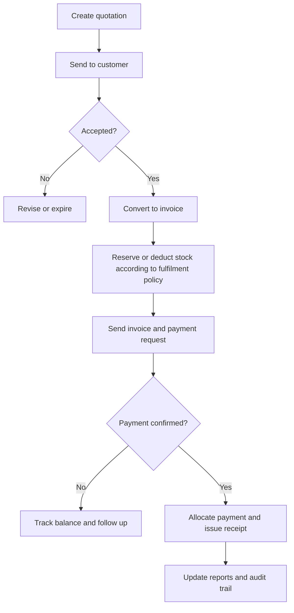
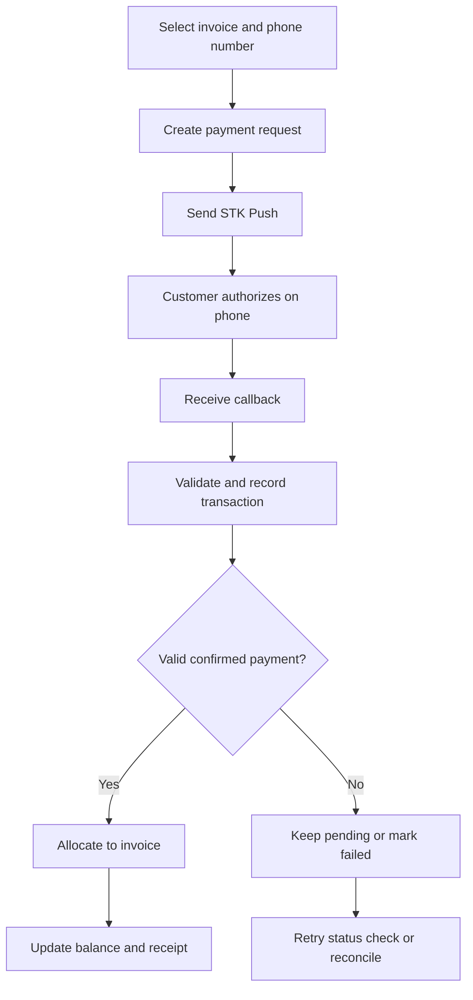
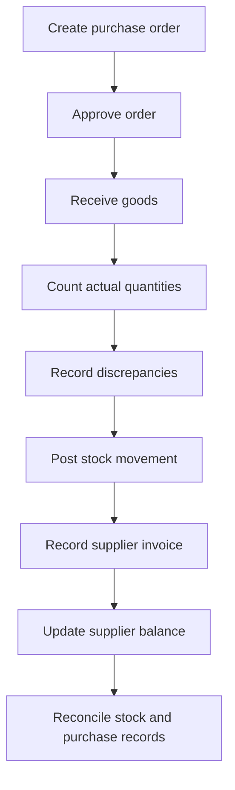

# Software Development Life Cycle (SDLC): Kenya POS & Business Management System

## 1. Project objective

Build a reliable, affordable Point of Sale (POS) platform for Kenyan SMEs that combines sales, quotations, invoicing, M-Pesa payments, inventory, supplier management, profitability reporting, and eTIMS reconciliation.

The product should help business owners answer five questions:

- What have I sold?
- Who owes me money?
- How much cash have I received?
- What stock do I have, and what needs replenishing?
- Am I making a profit, and can I reconcile my tax records?

Develop this in phases, beginning with a usable MVP that can be tested by real Kenyan businesses before investing in more advanced features.

## 2. Functional requirements

### Module 1 — Quotations and invoicing

- Create, edit, approve, and send quotations.
- Generate sequential quotation and invoice numbers.
- Convert an accepted quotation into an invoice with one action.
- Preserve customer details, prices, discounts, tax treatment, and item quantities during conversion.
- Support partial payments, credit sales, due dates, and overdue invoices.
- Generate printable PDFs and share documents electronically.

### Module 2 — M-Pesa payment integration

- Initiate an STK Push to the customer's phone.
- Track pending, successful, failed, and cancelled payment requests.
- Receive and validate payment callbacks.
- Match payments to invoices using invoice references, transaction IDs, and amounts.
- Allocate partial payments and identify unmatched transactions.
- Issue receipts and update outstanding customer balances after confirmed payment.

### Module 3 — Customer account management

- Maintain customer profiles, contacts, and KRA PINs where required.
- Track invoices, receipts, credit limits, and outstanding balances.
- Show customer statements and payment histories.
- Generate overdue-payment reminders.
- Record credit notes, refunds, and account adjustments with an audit trail.

### Module 4 — Inventory and stock control

- Create products, SKUs, barcodes, units of measure, and categories.
- Record opening stock, sales, purchases, returns, transfers, and adjustments.
- Calculate stock on hand and stock valuation.
- Reconcile physical counts against system balances.
- Maintain stock movement history and require reasons for adjustments.
- Trigger low-stock alerts based on configurable reorder levels.

### Module 5 — Suppliers and procurement

- Register suppliers and maintain their account details.
- Create and approve purchase orders.
- Track ordered, received, outstanding, and cancelled quantities.
- Receive goods against purchase orders and record discrepancies.
- Record supplier invoices, payments, and balances.
- Update inventory only when goods are received, not merely when a purchase order is created.

### Module 6 — Sales, stock, and financial reports

- Daily, weekly, and monthly sales and invoice reports.
- Product, category, cashier, and payment-method analysis.
- Gross profit by product and sales period.
- Operating expenses, cost of goods sold, and profit-and-loss summaries.
- Inventory valuation, stock movement, and stock variance reports.
- Customer debtors, supplier creditors, and cash reconciliation.

### Module 7 — Kenyan tax and eTIMS reconciliation

- Configure applicable tax rates and tax-inclusive or tax-exclusive pricing.
- Record tax amounts separately from sales revenue.
- Integrate with an approved or supported KRA eTIMS route, subject to current requirements.
- Track invoice submission status, acknowledgements, errors, and retries.
- Reconcile POS invoices with eTIMS records and identify missing, duplicate, or mismatched documents.
- Export reconciliation reports for accountants and tax filing workflows.

**Important:** eTIMS is not just another report. Confirm the applicable KRA integration route and current development, testing, vetting, and certification requirements before promising production compliance. KRA provides system-to-system integration options, including OSCU and VSCU. Consult the [KRA eTIMS information](https://www.kra.go.ke/) and relevant official technical documentation.

### Module 8 — Alerts and notifications

- Low-stock and out-of-stock warnings.
- Overdue customer invoices.
- Failed or pending M-Pesa transactions.
- Failed eTIMS submissions and reconciliation differences.
- Purchase orders awaiting approval or delivery.
- Daily sales and cash summaries for business owners.

## 3. SDLC phases and development roadmap

The project should follow an iterative SDLC: requirements, design, development, testing, deployment, and continuous improvement. Each phase must have a deliverable and a sign-off condition.

### Phase 1 — Discovery and requirements (Week 1)

**Activities**
- Interview 5–10 potential businesses.
- Map their current sales, payment, and stock workflows.
- Define user roles and permissions.
- Prioritize MVP requirements.
- Identify integration and compliance dependencies.

**Deliverables**
- Approved Product Requirements Document (PRD).
- User stories and acceptance criteria.
- MVP scope and prioritized backlog.

### Phase 2 — UX/UI and technical architecture (Week 2)

**Activities**
- Design the dashboard, POS screen, quotation workflow, invoice screen, inventory pages, and reports.
- Define database entities and relationships.
- Define API contracts and integration boundaries.
- Design tenant isolation, permissions, and audit logging.

**Deliverables**
- Clickable prototype.
- Data model.
- Technical architecture.
- Initial test plan.

### Phase 3 — Core application development (Weeks 3–5)

**Activities**
- Implement business accounts and user access.
- Implement products, stock movements, customers, quotations, and invoices.
- Implement manual payment recording.
- Build core sales and inventory reports.

**Deliverable**
- Working MVP with end-to-end sales and inventory workflows.

### Phase 4 — Integrations and financial controls (Weeks 6–7)

**Activities**
- Implement M-Pesa payment prompting and callback processing.
- Implement purchase orders, supplier balances, and goods receiving.
- Implement tax calculations and eTIMS integration groundwork.
- Build exception handling, reconciliation, and retry processes.

**Deliverable**
- Tested integrations in sandbox, reconciliation tools, and exception handling.

### Phase 5 — Quality assurance and compliance testing (Week 8)

**Activities**
- Test calculations, permissions, stock accuracy, duplicate payments, and integration failures.
- Test backup and recovery.
- Conduct security and reporting checks.
- Resolve critical defects.

**Deliverables**
- Test evidence.
- Defect register.
- Security review.
- Release approval.

### Phase 6 — Pilot deployment (Weeks 9–10)

**Activities**
- Onboard 3–5 pilot businesses.
- Import opening stock and customer data.
- Configure tax and payment settings.
- Train users.
- Compare system reports with real transactions.

**Deliverables**
- Pilot report.
- Customer feedback.
- Prioritized fixes.

### Phase 7 — Production launch and improvement (ongoing)

**Activities**
- Launch after critical acceptance tests pass.
- Monitor errors, backups, performance, adoption, and support requests.
- Release improvements in short iterations.

**Deliverables**
- Production release.
- Operating procedures.
- Product backlog and maintenance plan.

*These are planning estimates, not guaranteed completion dates. Full eTIMS certification, complex accounting, and production payment approvals may extend the schedule.*

## 4. MVP versus later releases

Avoid attempting to build a complete ERP system in version one.

| Capability | MVP | Later enhancement |
|---|---|---|
| Quotations and invoices | Create, PDF, convert, track balances | Templates and automated reminders |
| M-Pesa | STK Push, payment confirmation, allocation | Automated settlement matching |
| Customer accounts | Profiles, statements, debts | Advanced credit scoring |
| Inventory | Stock movements, balances, adjustments | Multi-warehouse transfers and forecasting |
| Suppliers | Supplier records, purchase orders, receiving | Supplier performance analytics |
| Reports | Sales, stock, gross profit, basic P&L | Advanced analytics and budgeting |
| eTIMS | Tax configuration, reconciliation design, sandbox integration | Approved production integration |
| Alerts | Low stock, overdue invoices, failed transactions | Predictive replenishment and custom rules |

Use Safaricom's official [Daraja developer platform](https://developer.safaricom.co.ke/) for M-Pesa integration, and test in the sandbox before seeking production access.

## 5. Recommended technical architecture

Build a mobile-friendly, multi-tenant web application that works on Android phones, tablets, and desktop computers. One software platform can serve many businesses while keeping each business's data separate.

### Architecture layers

1. **User interface:** POS terminal, mobile interface, tablet, and admin dashboard.
2. **Application API and authentication:** tenant isolation, user roles, validation, and audit logs.
3. **Business modules:** sales, customers, stock, suppliers, and reporting.
4. **Financial services:** payments, tax, cost of sales, and reconciliation.
5. **Database:** transactional records, stock ledger, financial ledger, and audit history.
6. **External integrations:** M-Pesa Daraja and KRA eTIMS.

### Suggested stack

| Layer | Recommendation |
|---|---|
| Frontend | Next.js, React, and TypeScript |
| UI components | Tailwind CSS and a reusable component library |
| Backend | NestJS with TypeScript |
| Database | PostgreSQL |
| Database access | Prisma ORM |
| Background jobs | Redis with a job queue |
| Authentication | Secure sessions, role-based access, and optional MFA |
| File storage | Private object storage for PDFs and exports |
| Hosting | Managed cloud application hosting and managed PostgreSQL |
| Monitoring | Centralized logs, error tracking, and uptime monitoring |

This is a recommended stack, not a fixed requirement. Validate it against developer skills, operating costs, and hosting budget before implementation.

## 6. Core business workflows

### Workflow A — Quotation to paid invoice

**Rules**
- Conversion must preserve quotation line items and prices.
- The invoice must reference the original quotation.
- A quotation alone must not reduce stock or count as revenue.
- Define whether stock is deducted at invoicing, dispatch, or sale completion according to the target business workflow.

### Workflow B — M-Pesa payment

**Critical control:** never mark an invoice paid merely because an STK Push was initiated or the customer says they paid. Verify the successful transaction and prevent duplicate allocation if a callback is delivered more than once.

### Workflow C — Purchase and stock reconciliation

**Rules**
- A purchase order alone must not increase stock.
- Inventory increases when goods are received and accepted.
- Physical stock counts create adjustment records with reasons and authorization.
- Supplier invoices and payments must be tracked separately from goods receiving.

## 7. Database design

| Entity | Purpose |
|---|---|
| `businesses` | Each subscribing business |
| `branches` | Branches, tills, and locations |
| `users`, `roles`, `permissions` | Access control |
| `customers` | Customer account details |
| `suppliers` | Supplier records |
| `products`, `product_categories` | Items, SKUs, prices, and tax classifications |
| `quotations`, `quotation_items` | Quotations and their lines |
| `invoices`, `invoice_items` | Sales invoices and line items |
| `payments`, `payment_allocations` | Payment transactions and invoice allocations |
| `credit_notes`, `refunds` | Reversals and corrections |
| `stock_movements`, `stock_counts` | Inventory ledger and reconciliation |
| `purchase_orders`, `goods_receipts` | Procurement and receiving |
| `supplier_invoices` | Supplier liabilities |
| `expenses`, `accounting_entries` | Financial reporting |
| `tax_records`, `etims_submissions` | Tax records, submission status, and responses |
| `notifications` | Alerts and delivery status |
| `audit_logs` | Who did what, when, and why |

### Data design requirements

- Every business-owned record should include a `business_id`.
- Branch-sensitive records should also include a `branch_id` where applicable.
- Enforce tenant isolation at the application and database levels.
- Use database transactions for completing sales, posting stock movements, and allocating payments.
- Keep an immutable or tightly controlled audit history for posted financial and stock transactions.
- Use unique constraints for invoice numbers within the relevant business or branch scope.
- Store monetary values using appropriate decimal/numeric types, not floating-point types.

## 8. Reporting and accounting rules

The dashboard must distinguish cash received from sales earned and profit generated.

### Example daily summary

Assume net sales exclude applicable sales taxes, returns, and discounts, and all stated costs relate to the same period.

| Metric | Example |
|---|---:|
| Net sales | KSh 100,000 |
| Cost of goods sold | KSh 65,000 |
| Gross profit | KSh 35,000 |
| Operating expenses | KSh 10,000 |
| Operating profit before other items and tax | KSh 25,000 |

### Required calculations

- **Net sales:** sales excluding applicable tax, less returns and discounts.
- **Cost of goods sold:** cost attributable to the goods actually sold.
- **Gross profit:** net sales minus cost of goods sold.
- **Operating profit:** gross profit minus operating expenses, adjusted for other operating income or expenses as appropriate.
- **Outstanding receivables:** invoices less allocated payments and applicable credits.
- **Stock variance:** physical count less expected system quantity.
- **Tax reconciliation differences:** discrepancies between POS tax records and eTIMS records.

Choose a consistent inventory costing method, such as weighted-average cost, and document how purchase costs, returns, and stock adjustments affect valuation. Have an accountant validate the accounting rules and reports before production use.

## 9. Acceptance testing

A feature is not complete just because the screen works. It must pass defined tests.

| Test | Expected result |
|---|---|
| Convert an accepted quotation | One linked invoice is created without duplicate conversion |
| Request an M-Pesa payment | Request is logged; invoice remains unpaid until confirmation |
| Receive a duplicate callback | No duplicate payment or invoice allocation |
| Receive partial payment | Balance decreases by the confirmed amount only |
| Sell an item | Stock decreases according to the configured fulfilment policy |
| Receive purchased goods | Stock increases by accepted quantities |
| Complete a stock count | Variance is recorded with an authorized adjustment |
| Trigger a reorder level | Alert is generated according to the configured alert rules |
| Reconcile eTIMS | Missing, failed, and mismatched submissions are identifiable |
| Generate a P&L report | Totals agree with the underlying posted transactions |
| Access another business's records | Access is denied |
| Restore a backup | Data can be recovered and reconciled |

### Definition of done

A release should not proceed until:

- All critical acceptance tests pass.
- Financial and stock calculations reconcile.
- Payment and tax integration errors are recoverable.
- Authorization and tenant-isolation tests pass.
- Backups and recovery have been tested.
- Pilot users can complete the main workflows without developer intervention.
- Outstanding defects are documented and approved for release.

## 10. Security, reliability, and operations

Include these requirements from the first sprint.

- Encrypt network traffic and protect payment credentials and API secrets.
- Enforce role-based permissions for cashiers, supervisors, accountants, and owners.
- Log price overrides, stock adjustments, invoice cancellations, and refunds.
- Never silently delete posted financial transactions; use controlled reversals or credit notes.
- Make payment callbacks idempotent and validate authenticity using the applicable integration controls.
- Provide backup monitoring, restore testing, error alerts, and integration retry queues.
- Support low-bandwidth usage and provide a clear recovery path for temporary connectivity failures.
- Define how offline sales are queued and synchronized, including conflict handling and duplicate prevention, before enabling offline mode.
- Establish data retention, privacy, incident response, and access-revocation procedures.

## 11. Implementation priorities and budget control

### Gate 1 — Core MVP

- Quotations and invoices.
- Customers and products.
- Stock movements and balances.
- Basic sales reporting.
- Manual payment recording.

### Gate 2 — Operational automation

- M-Pesa integration.
- Purchase orders and supplier balances.
- Low-stock alerts.
- Customer statements and payment reminders.

### Gate 3 — Tax and financial controls

- eTIMS integration and applicable certification process.
- Tax reconciliation.
- Stock valuation.
- Reliable profit-and-loss reporting.

### Gate 4 — Commercial scale

- Multi-branch operations.
- Subscription billing.
- Customer onboarding.
- Tenant administration.
- Advanced analytics and support tooling.

Do not commit to a development budget until the prototype, integration route, and pilot scope are agreed. Estimate M-Pesa production access, eTIMS certification, hosting, support, and maintenance separately.

## 12. Recommended next step

Define the target customer and operating model before finalizing the technical backlog. A retail shop, wholesaler, hardware store, and service business can require different workflows.

Confirm these choices:

1. **Primary target customer:** retail shops; wholesalers/distributors; hardware/building-material shops; service businesses; or multiple SME sectors.
2. **Initial platform:** mobile-friendly web app; Android app; or web app with offline sales support.
3. **Business model:** SaaS subscription for multiple businesses or software for one business initially.
4. **Development approach:** AI-assisted solo development, one developer with AI tools, or a small team.
5. **Initial budget:** under KSh 100,000; KSh 100,000–300,000; KSh 300,000–1,000,000; or not yet determined.

**Recommendation:** start with one customer segment, validate the core workflow with a few businesses, and design the architecture so additional sectors can be supported later without rewriting the system.
